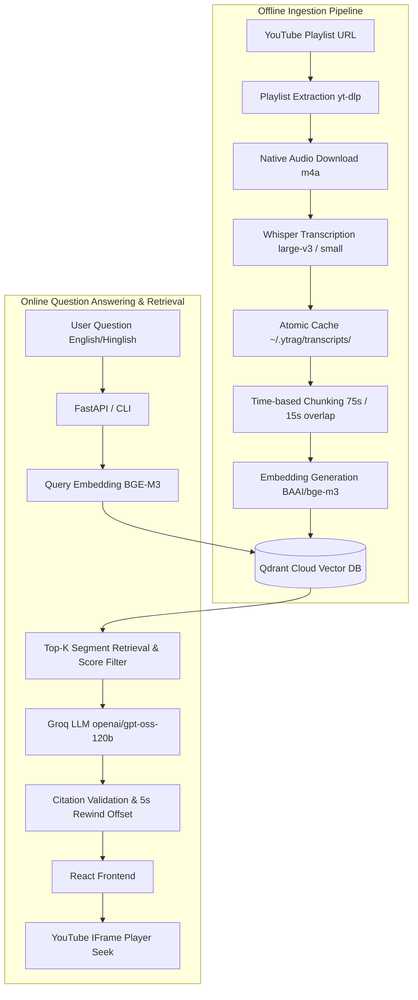

# VidSage

> **Your videos. Your knowledge. Instantly.**

VidSage is an AI-powered YouTube lecture search and revision assistant. It converts educational YouTube playlists into searchable, timestamp-aware knowledge, enabling students and engineers to pinpoint the exact explanation, video, and timestamp for any concept in seconds.

---

## 📌 Problem Statement

Students watch hundreds of hours of video lectures (such as Data Structures & Algorithms, Machine Learning, and System Design playlists). When revising for examinations or technical interviews, finding where a specific topic or subtle nuance was explained (e.g. *Memoization vs Tabulation*, *Dijkstra's time complexity*) is tedious. Standard YouTube search only searches titles, descriptions, and coarse caption keywords without jumping directly to the exact timestamp where the explanation takes place.

VidSage solves this problem by transcribing lecture playlists with high-fidelity speech-to-text (**faster-whisper**), chunking transcripts with precise timestamp boundaries, generating dense vector embeddings (**BAAI/bge-m3**), indexing them in **Qdrant Cloud**, and providing grounded LLM answers (**Groq / openai/gpt-oss-120b**) with clickable citations that jump directly to that moment inside an embedded YouTube player.

---

## 🏗️ Architecture & Pipeline Workflow



---

## 🛠️ Technology Stack

| Layer | Component | Technology | Rationale |
|---|---|---|---|
| **Audio & Speech** | Audio Extraction | `yt-dlp` | Fast native `.m4a` extraction without unnecessary transcoding |
| | Transcription | `faster-whisper` | CTranslate2 inference engine with float timestamp fidelity |
| **Vector Search** | Dense Embeddings | `sentence-transformers` (`BAAI/bge-m3`) | SOTA multi-lingual & cross-lingual 1024-dim representations |
| | Vector Database | `Qdrant Cloud` | Cloud vector engine with Cosine distance and payload filtering |
| **LLM Reasoning** | Inference Provider | `Groq` | Sub-second ultra-low latency response generation |
| | Foundation Model | `openai/gpt-oss-120b` | High factual grounding and natural Hinglish/English reasoning |
| **Backend & CLI** | Framework | `FastAPI` + `Uvicorn` | Asynchronous REST API with Pydantic v2 schemas and rate limiting |
| | CLI Tool | `Typer` + `Rich` | Beautiful interactive terminal interface |
| | Package Manager | `uv` (Python 3.11) | Ultra-fast Rust-based Python dependency management |
| **Frontend** | UI Framework | `React` + `Vite` + `Tailwind CSS` | Modern responsive dark-mode UI with Lucide React icons |
| | Video Playback | YouTube IFrame Player API | In-page embedded video player with millisecond seek navigation |

---

## 📂 Project Structure

```text
vidsage/
├── ytrag/                      # Core AI & RAG Engine
│   ├── __init__.py
│   ├── config.py              # Pydantic Settings & path resolution
│   ├── models.py              # Video, Segment, Chunk, and Citation models
│   ├── playlist.py            # yt-dlp metadata extraction & audio downloader
│   ├── transcribe.py          # faster-whisper atomic caching pipeline
│   ├── chunk.py               # Time-based boundary chunking & hallucination filter
│   ├── embed.py               # BAAI/bge-m3 dense embedder abstraction
│   ├── index.py               # High-level Qdrant vector operations
│   ├── answer.py              # Grounded RAG answering & citation validation
│   ├── evaluate.py            # Evaluation metrics (hit rate, refusal accuracy)
│   ├── services/
│   │   ├── qdrant_service.py  # Qdrant client connection & collection management
│   │   └── groq_service.py    # Groq API completion wrapper
│   └── cli.py                 # Typer Rich CLI commands
│
├── api/                       # FastAPI REST API Backend
│   ├── __init__.py
│   ├── main.py                # App entrypoint, CORS, logging, lifespan
│   ├── routes/
│   │   ├── health.py          # GET /health
│   │   ├── ask.py             # POST /ask
│   │   ├── search.py          # POST /search
│   │   ├── videos.py          # GET /videos, GET /videos/{video_id}
│   │   └── playlists.py       # GET /playlists
│   ├── schemas/
│   │   ├── request.py         # AskRequest, SearchRequest
│   │   └── response.py        # AskResponse, HealthResponse, VideoItem
│   └── services/
│       └── rate_limiter.py    # Sliding-window in-memory IP rate limiter
│
├── frontend/                  # React + Vite Frontend
│   ├── src/
│   │   ├── components/
│   │   │   ├── Navbar.jsx
│   │   │   ├── SearchBar.jsx
│   │   │   ├── AnswerCard.jsx
│   │   │   ├── CitationCard.jsx
│   │   │   ├── VideoPlayer.jsx
│   │   │   ├── VideoResult.jsx
│   │   │   └── LoadingState.jsx
│   │   ├── hooks/
│   │   │   └── useYouTubePlayer.js # YouTube IFrame API seek hook
│   │   ├── services/
│   │   │   └── api.js         # HTTP client
│   │   ├── App.jsx            # Main view & layout
│   │   ├── main.jsx
│   │   └── index.css
│   ├── package.json
│   └── vite.config.js
│
├── eval/
│   └── golden.json            # Benchmark test dataset
├── tests/
│   ├── test_chunk.py          # Chunking & hallucination unit tests
│   ├── test_transcribe.py     # Atomic caching unit tests
│   ├── test_answer.py         # Citation extraction & refusal tests
│   └── test_api.py            # FastAPI endpoint tests
│
├── transcripts/               # Exported distribution transcripts
├── .env.example               # Configuration template
├── pyproject.toml             # Python package configuration
└── README.md
```

---

## 🚀 Quick Start (Development)

### Prerequisites

- **Python 3.11** (managed via `uv`)
- **uv**: `winget install astral-sh.uv` or `curl -LsSf https://astral.sh/uv/install.sh | sh`
- **Node.js 18+** & `npm`
- **Groq API Key**: Free at [console.groq.com](https://console.groq.com)
- **Qdrant Cloud Account**: Free cluster at [cloud.qdrant.io](https://cloud.qdrant.io)

---

### 1. Environment Setup

```powershell
# Clone the repository
git clone https://github.com/govindkh04/vidsage.git
cd vidsage

# Create Python 3.11 virtual environment
uv venv --python 3.11

# Install backend dependencies
uv sync

# Configure environment variables
cp .env.example .env
```

Edit `.env` and fill in your credentials:
```env
GROQ_API_KEY=gsk_...
QDRANT_URL=https://your-cluster-id.aws.cloud.qdrant.io
QDRANT_API_KEY=eyJ...
```

---

### 2. Verify Preflight Diagnostics

Run the preflight health check to verify all services and credentials:
```powershell
uv run ytrag preflight
```

---

### 3. Ingest Video Lectures

Ingest a single lecture or an entire playlist into the knowledge base:
```powershell
# Ingest single video
uv run ytrag ingest --video "S8tpzqrwnHk" --model small

# Ingest first N videos from playlist
uv run ytrag ingest --playlist "https://youtube.com/playlist?list=PLbJhGqY-mq47k_WLUtzVjmarUm1EuXPj2" --limit 3

# View indexing statistics
uv run ytrag stats
```

> **Note on Caching**: Transcripts are saved permanently in `~/.ytrag/transcripts/`. If you re-run ingestion, audio downloading and transcription are automatically skipped, and chunks are upserted idempotently with deterministic UUIDs.

---

### 4. Ask Questions via CLI

Ask questions in English or Hinglish from your terminal:
```powershell
# Grounded question
uv run ytrag ask "Video schedule aur consistency ke baare me kya bataya gaya hai?"

# Out-of-domain query (triggers automatic refusal)
uv run ytrag ask "React hooks kaise kaam karte hain?"

# Direct semantic retrieval without LLM
uv run ytrag search "DSA patterns roadmap beginner"
```

---

### 5. Run the Automated Evaluation Suite

VidSage includes a ground-truth benchmark verifying Hit Rate @ 5, Refusal Accuracy, and Timestamp Error:
```powershell
uv run ytrag eval
```

Run all unit and API tests with `pytest`:
```powershell
uv run pytest -v
```

---

### 6. Start the Backend API Server

Start the FastAPI backend with hot reloading:
```powershell
uv run uvicorn api.main:app --reload --port 8000
```
- API Base URL: `http://localhost:8000`
- Interactive Swagger Docs: `http://localhost:8000/docs`

---

### 7. Start the React Frontend

In a separate terminal:
```powershell
cd frontend
npm install
npm run dev
```
Open **`http://localhost:5173`** in your browser!

1. Type any question (e.g. *"Video schedule ke baare me kya bataya gaya hai?"*).
2. Read the concise, grounded answer.
3. Click any citation card: **the embedded video player immediately loads the exact lecture and seeks 5 seconds before the explanation!**

---

## 🔒 Security & Grounding Philosophy

1. **Zero Hallucination Guarantee**: If retrieved segments do not pass the relevance similarity threshold, the model refuses to answer (`"Ye topic in lectures me cover nahi hua."`).
2. **Citation Validation**: Any citation reference emitted by the LLM (`[1]`, `[2]`) is verified against retrieved chunks. Ungrounded citations are rejected.
3. **No Secret Leaks**: Credentials (`GROQ_API_KEY`, `QDRANT_API_KEY`) remain strictly on the backend and are never passed to the frontend.
4. **Rate Limiting**: The `/ask` endpoint enforces in-memory rate limiting (30 requests/minute per IP).

---

## 📄 License

MIT License. See [LICENSE](LICENSE) for details.
