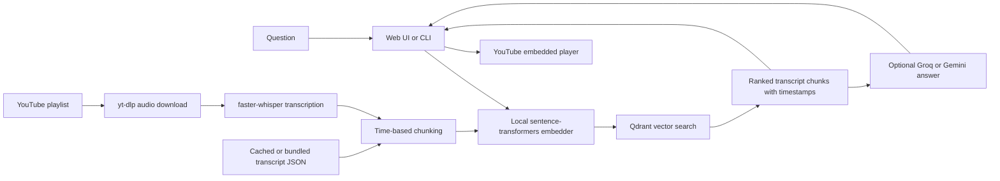

# VidSage

VidSage searches timestamped transcripts of DSA lectures and takes you to the
relevant moment in the video. Ask in English or Hinglish, browse ranked
transcript matches, and request a summary grounded in the retrieved excerpts.

The project includes 126 transcript JSON files. Build a local search index from
them without downloading lecture audio or running speech recognition.

## Features

- Semantic search over timestamped lecture excerpts.
- Clickable results that play at the matching point in an embedded YouTube
  player.
- Optional grounded answers and summaries using Groq or Gemini.
- Local Qdrant storage by default; Qdrant Cloud is optional.
- CLI workflows to ingest playlists, cache transcripts, rebuild the index, and
  evaluate retrieval.
- Re-runnable ingestion with cached transcripts and deterministic Qdrant point
  IDs.

## How it works



The embedder runs locally. Qdrant stores vectors and transcript payloads either
in a local on-disk database or in a configured cloud collection. Search does
not call an LLM; the `/ask` endpoint does.

## Tech stack

| Area | Technology |
|---|---|
| Language | Python 3.11 or 3.12 |
| Dependency management | [uv](https://docs.astral.sh/uv/) |
| Playlist metadata and audio | `yt-dlp` |
| Transcription | `faster-whisper` / CTranslate2 |
| Time-aware chunking | Project implementation in `ytrag/chunk.py` |
| Local embeddings | `sentence-transformers`; default `all-MiniLM-L6-v2` |
| Vector database | Qdrant client: embedded local storage or Qdrant Cloud |
| Optional answer generation | Groq or Google Gemini APIs |
| CLI | Typer and Rich |
| HTTP API | FastAPI, Pydantic, and Uvicorn |
| Browser playback | YouTube IFrame Player API, with an embedded-player fallback |

## Repository structure

```text
VidSage/
├── api/
│   ├── main.py                 # FastAPI app, endpoints, and startup
│   └── static/
│       └── index.html          # Single-page search UI and YouTube player
├── eval/
│   ├── golden.json             # Default retrieval/refusal evaluation set
│   └── golden_draft.json       # Draft retrieval examples; not used by default
├── index/                      # Optional exported vector index (not included)
├── transcripts/                # 126 bundled transcript JSON files
├── ytrag/
│   ├── answer.py               # Retrieval, grounded answers, citations
│   ├── chunk.py                # Time-window chunking and repetition filtering
│   ├── cli.py                  # Typer CLI commands
│   ├── config.py               # Environment configuration and runtime paths
│   ├── embed.py                # Sentence-transformers embedder
│   ├── evaluate.py             # Golden-set evaluation
│   ├── index.py                # Qdrant collection, search, and vector export
│   ├── models.py               # Video, segment, chunk, timestamp models
│   ├── playlist.py             # yt-dlp playlist/audio operations
│   ├── transcribe.py           # Whisper transcription and transcript cache
│   └── util.py                 # Network retry and connectivity helpers
├── .env.example                # Safe configuration template
├── .gitignore                  # Excludes local secrets and generated files
├── .python-version             # uv's Python version hint (3.11)
├── main.py                     # Convenience CLI entry point
├── pyproject.toml              # Dependencies and CLI entry point
└── uv.lock                     # Locked dependency resolution
```

The generated Qdrant database, downloaded audio, and live transcript cache are
stored outside the repository by default under `~/.ytrag/`. The `index/`
directory in this checkout does not contain a prebuilt vector file; create the
index from `transcripts/` with the setup steps below.

## Installation

### Requirements

- Python 3.11 or 3.12
- [uv](https://docs.astral.sh/uv/getting-started/installation/)
- Internet access on first run to download Python packages and the embedding
  model

### 1. Clone and install

Replace the placeholder with your GitHub repository URL:

```bash
git clone https://github.com/<YOUR-USERNAME>/VidSage.git
cd VidSage
uv python install 3.11
uv venv --python 3.11
uv sync
```

On Windows, if the project is in OneDrive and `uv sync` reports a hardlink or
cloud-file error, use copy mode:

```powershell
uv sync --link-mode=copy
```

Use `uv run --link-mode=copy` for the commands below in that environment.

### 2. Configure an LLM key (optional for search)

Copy the example file and add a Groq **or** Gemini key:

```powershell
Copy-Item .env.example .env
notepad .env
```

On macOS or Linux, use `cp .env.example .env` and edit `.env` with your editor.
Keep `.env` private; it is excluded by `.gitignore`.

Timestamp search works without an LLM key. The web app requests a generated
summary after a successful search, so configure a key to use that feature.

### 3. Build the local vector index

From the repository root:

```bash
uv run ytrag reindex --transcripts transcripts
```

This embeds the bundled transcripts and writes the index to local Qdrant
storage. The first run downloads the embedding model; subsequent queries reuse
the cached model. No GPU, Qdrant account, or audio download is needed for this
step.

### 4. Start the web app

```bash
uv run ytrag serve
```

Wait for the embedding model to load, then open
[http://127.0.0.1:8000](http://127.0.0.1:8000). Stop the server with `Ctrl+C`.
The local embedded Qdrant database is single-process: stop `serve` before
running CLI commands that access that same database.

> **Windows/OneDrive:** If you needed copy mode during installation, run the
> commands as `uv run --link-mode=copy ytrag ...`, for example
> `uv run --link-mode=copy ytrag serve`.

## Configuration

The application loads `.env` from the current directory and reads settings
through `ytrag/config.py`. A Qdrant account is not required for local use.

### Secrets and service selection

```dotenv
# Add one key to enable generated summaries / answers.
GROQ_API_KEY=
GEMINI_API_KEY=

# Optional. Leave blank to use local Qdrant storage.
QDRANT_URL=
QDRANT_API_KEY=

# Optional: groq, gemini, or none.
# If omitted, Gemini is selected when GEMINI_API_KEY (or GOOGLE_API_KEY) is
# present; otherwise Groq is selected when GROQ_API_KEY is present.
# YTRAG_LLM_BACKEND=
```

`GEMINI_API_KEY` and the Google SDK-compatible `GOOGLE_API_KEY` are accepted.
If both provider keys are present and `YTRAG_LLM_BACKEND` is unset, Gemini is
selected. Leave `QDRANT_URL` blank for the local database at
`~/.ytrag/qdrant`; set both `QDRANT_URL` and `QDRANT_API_KEY` to use a hosted
Qdrant cluster.

### Environment variables

All settings are optional; the defaults below are used when omitted.

| Variable | Default | Purpose |
|---|---|---|
| `GROQ_API_KEY` | unset | Groq API key for generated answers |
| `GEMINI_API_KEY` / `GOOGLE_API_KEY` | unset | Gemini API key |
| `YTRAG_LLM_BACKEND` | auto / `none` | Select `groq`, `gemini`, or `none` |
| `YTRAG_LLM_MODEL` | provider default | Override the selected provider's model |
| `YTRAG_GROQ_MODEL` | `openai/gpt-oss-120b` | Groq model |
| `YTRAG_GEMINI_MODEL` | `gemini-2.0-flash` | Gemini model |
| `QDRANT_URL` | unset | Use Qdrant Cloud instead of local storage |
| `QDRANT_API_KEY` | unset | Authentication for hosted Qdrant |
| `YTRAG_ROOT` | `~/.ytrag` | Root for runtime data |
| `YTRAG_QDRANT_PATH` | `~/.ytrag/qdrant` | Local Qdrant database path |
| `YTRAG_COLLECTION` | `dsa_lectures` | Base collection name; embedding dimension is appended |
| `YTRAG_EMBED_MODEL` | `all-MiniLM-L6-v2` | Sentence-transformers model |
| `YTRAG_EMBED_BATCH` | `16` | Embedding batch size |
| `YTRAG_EMBED_QUERY_PREFIX` | empty | Optional prefix applied to query text |
| `YTRAG_TOP_K` | `6` | Default number of search results |
| `YTRAG_MAX_DISTANCE` | `0.6` | Maximum cosine distance passed to answer generation |
| `YTRAG_CONFIDENT_DISTANCE` | `0.45` | Distance threshold for the UI's confidence indicator |
| `YTRAG_TITLE_BOOST` | `0.06` | Ranking boost per meaningful title/query term overlap |
| `YTRAG_WHISPER_MODEL` | `large-v3` | faster-whisper model |
| `YTRAG_WHISPER_DEVICE` | `auto` | `auto`, `cuda`, or `cpu` |
| `YTRAG_WHISPER_COMPUTE` | auto | Compute type; defaults to `float16` on CUDA or `int8` on CPU |
| `YTRAG_WHISPER_LANG` | `en` | Whisper transcription language |
| `YTRAG_WHISPER_BEAM` | `5` | Whisper beam size |
| `YTRAG_WHISPER_BATCH` | `8` | Batched inference size; `0` disables batching |
| `YTRAG_CHUNK_SECONDS` | `75` | Target chunk time window |
| `YTRAG_CHUNK_OVERLAP` | `15` | Chunk overlap in seconds |
| `YTRAG_MIN_CHUNK_WORDS` | `15` | Minimum words for a chunk |
| `YTRAG_LINK_REWIND` | `5` | Seconds to rewind citation/player links |
| `YTRAG_UPSERT_BATCH` | `128` | Qdrant upsert batch size |
| `YTRAG_DOWNLOAD_SLEEP_MIN` / `YTRAG_DOWNLOAD_SLEEP_MAX` | `2` / `6` | Minimum and maximum delay between downloads, in seconds |
| `YTRAG_COOKIES_FILE` | unset | Optional yt-dlp `cookies.txt` path |
| `YTRAG_COOKIES_FROM_BROWSER` | unset | Optional browser cookie source |
| `YTRAG_MAX_QUESTION_CHARS` | `500` | API question length limit |
| `YTRAG_RATE_LIMIT_REQUESTS` | `20` | `/ask` requests allowed per client per window |
| `YTRAG_RATE_LIMIT_WINDOW` | `60` | `/ask` rate-limit window in seconds |

## Usage

### Search and ask from the CLI

```bash
# Retrieve timestamped transcript matches without an LLM call
uv run ytrag search "sliding window kab use kare"

# Generate a grounded answer (requires a configured Groq or Gemini key)
uv run ytrag ask "memoization aur tabulation me kya difference hai?"

# Show index and per-video statistics
uv run ytrag stats
```

### Use the web interface

```bash
uv run ytrag serve
```

Enter a question in English or Hinglish. VidSage searches the index, shows
ranked moments, and loads the best match in the video player. With an LLM key
configured, it also requests a grounded summary. If a summary cannot be
generated, the UI shows the error and offers a retry.

### Ingest a different playlist

The bundled transcripts are sufficient to try the application. To index a
different playlist, configure `YTRAG_WHISPER_LANG` as appropriate, then run:

```bash
# Check recognition in both configured language modes on one video
uv run ytrag langtest "https://www.youtube.com/watch?v=<VIDEO_ID>"

# Try a single video before starting a full playlist
uv run ytrag ingest --playlist "<PLAYLIST_URL>" --limit 1

# Ingest the playlist
uv run ytrag ingest --playlist "<PLAYLIST_URL>"
```

Ingestion downloads audio, reuses cached transcripts when available,
transcribes missing videos, chunks the segments, and upserts the vectors. Audio
is deleted after transcription unless `--keep-audio` is used. A GPU is
recommended for a large playlist; the CPU path is supported but slower. The
optional CUDA dependencies can be installed with `uv sync --extra cuda`.

Useful ingestion options:

| Option | Effect |
|---|---|
| `--limit N` | Process only the first `N` playlist videos |
| `--skip-transcribe` | Skip videos without cached transcripts |
| `--keep-audio` | Keep downloaded audio after transcription |
| `--force` | Re-transcribe even when a transcript is cached |
| `--stop-after-failures N` | Stop after `N` consecutive video failures; default `5` |

### Rebuild or manage the index

```bash
# Re-chunk and re-embed available transcripts; does not transcribe
uv run ytrag reindex

# Rebuild from a specific transcript folder
uv run ytrag reindex --transcripts transcripts

# Remove existing chunks per video first (useful after changing chunk settings)
uv run ytrag reindex --replace

# Check transcript-ingestion progress, then clean cached audio if desired
uv run ytrag progress
uv run ytrag clean-audio
```

`reindex` uses the live transcript cache when present, otherwise it falls back
to the bundled `transcripts/` directory. Changing the embedding model or chunk
settings requires rebuilding the index; the embedding dimension is part of the
Qdrant collection name.

### Evaluate retrieval

```bash
uv run ytrag eval --verbose
```

The default `eval/golden.json` contains refusal checks and retrieval templates.
Add real retrieval entries with expected video IDs and timestamps for useful
retrieval accuracy measurements. `eval/golden_draft.json` contains draft
examples but is not selected by default; pass it explicitly with
`uv run ytrag eval --path eval/golden_draft.json`.
There is no separate automated unit-test suite in the current repository.

## HTTP API

Start the API and UI with `uv run ytrag serve`. FastAPI's interactive
documentation is available at `/docs`; the OpenAPI schema is at `/openapi.json`.

| Method | Path | Description |
|---|---|---|
| `GET` | `/` | Serves the VidSage web UI |
| `GET` | `/health` | Basic app/model health information |
| `GET` | `/meta` | Indexed lecture count and total indexed hours |
| `GET` | `/stats` | Collection name, existence, chunk count, and embedding details |
| `POST` | `/search` | Retrieve timestamped chunks; no LLM required |
| `POST` | `/ask` | Generate a grounded answer with citations; requires an LLM key |

Both `POST` endpoints accept the same JSON body. `top_k` is optional and must
be between 1 and 20; `question` must contain 1–500 characters by default.

```json
{
  "question": "memoization aur tabulation me kya difference hai?",
  "top_k": 6
}
```

`POST /search` returns a `query`, a `confident` indicator, and ranked `results`.
Each result contains a lecture `title`, `timestamp`, `video_id`, `start_sec`,
`end_sec`, YouTube `url`, transcript `preview`, and vector `distance`.

`POST /ask` returns an `answer`, `grounded` boolean, `retrieved` count, and
`citations` array. A citation includes the lecture title, timestamp, video ID,
YouTube URL, start time, and distance. The `/ask` route is rate-limited per
client in the current process; `/search` is not.

## Screenshots and demo

No hosted demo URL or screenshot asset is currently included in this repository.
Add a screenshot under `docs/` and link it here when one is available.

## Future improvements

- Add a real, maintained retrieval golden set and automated unit tests.
- Update `preflight` to validate whichever LLM and Qdrant backends are selected.
- Move API rate-limit state to shared storage before deploying multiple workers.
- Add a deployment configuration and a hosted demo.

## Troubleshooting

- **`uv sync` hardlink/cloud-file error on Windows:** retry with
  `uv sync --link-mode=copy`; use `uv run --link-mode=copy ...` for commands.
- **`GROQ_API_KEY` or `GEMINI_API_KEY` missing:** search still works, but
  summaries and `ytrag ask` need a provider key in `.env`.
- **Local Qdrant storage already accessed:** stop the running `ytrag serve`
  process before running CLI commands against the same local database. Use
  hosted Qdrant if multiple processes need concurrent access.
- **Embedding model mismatch:** keep the same `YTRAG_EMBED_MODEL` used to build
  the index, or rebuild it with `ytrag reindex`.
- **`ytrag preflight` reports missing Groq/Qdrant URL:** the current preflight
  implementation explicitly checks `GROQ_API_KEY` and `QDRANT_URL`, even
  though Gemini and local Qdrant are supported. This check can therefore fail
  for valid local/Gemini configurations.
- **YouTube player does not embed:** browser extensions, network policy, or
  video-owner settings may block playback. The UI provides an embedded-player
  fallback when the IFrame API is unavailable; some videos may still only play
  on YouTube.

## Contributing

Issues and pull requests are welcome. For changes, include a concise
description of the behavior changed and the commands or evaluation used to
verify it. Keep credentials in `.env`; do not commit secrets.

## License

This repository currently has no `LICENSE` file. Do not assume it is available
under an open-source license; add a license before redistributing or reusing the
project.
