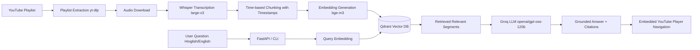

# VidSage

> **Your videos. Your knowledge. Instantly.**

VidSage is an AI-powered YouTube lecture search and revision assistant. It converts educational YouTube playlists into searchable, timestamp-aware knowledge, enabling students and engineers to pinpoint the exact explanation, video, and timestamp for any concept in seconds.

---

## 📌 Problem Statement

Students watch hundreds of hours of technical video lectures, but when revising for exams or technical interviews, finding where a specific topic or subtle nuance was explained (e.g. *Memoization vs Tabulation*, *Dijkstra's time complexity*) is tedious. Standard YouTube search only searches metadata and full video captions, failing to jump to the exact moment.

VidSage indexes lecture playlists using speech-to-text with timestamps, generates dense vector representations, and provides grounded retrieval and citations with in-page embedded video seeking.

---

## 🏗️ Architecture Workflow



---

## 🛠️ Technology Stack

| Layer | Component | Technology |
|---|---|---|
| **Audio & Speech** | Audio Extraction | `yt-dlp` |
| | Transcription | `faster-whisper` (`large-v3`, CTranslate2) |
| **Vector Search** | Embeddings | `sentence-transformers` (`BAAI/bge-m3`) |
| | Vector Database | `Qdrant Cloud` |
| **LLM Reasoning** | Inference Provider | `Groq` |
| | Foundation Model | `openai/gpt-oss-120b` |
| **Backend & CLI** | Framework | `FastAPI` + `Uvicorn` |
| | CLI Tool | `Typer` + `Rich` |
| | Dependency & Env | `uv` (Python 3.11) |
| **Frontend** | UI Framework | `React` + `Vite` + `Tailwind CSS` |
| | Video Playback | YouTube IFrame Player API |

---

## 🚀 Quick Start (Development)

### Prerequisites

- **Python 3.11** (managed automatically via `uv`)
- **uv** package manager
- **Git**
- **Groq API Key**
- **Qdrant Cloud** cluster URL and API key

### 1. Environment Setup

```powershell
# Clone the repository (if not already done)
git clone https://github.com/<your-username>/vidsage.git
cd vidsage

# Create Python 3.11 virtual environment using uv
uv venv --python 3.11

# Install project dependencies
uv sync

# Configure environment variables
cp .env.example .env
# Edit .env and enter your GROQ_API_KEY and QDRANT credentials
```

### 2. Verification

```powershell
# Verify environment and dependencies
uv run python -c "import ytrag; print('VidSage environment ready!')"
```

---

## 📂 Project Structure

```text
vidsage/
├── ytrag/               # Core ingestion, transcription, chunking, and RAG logic
├── api/                 # FastAPI REST API backend
├── frontend/            # React + Vite frontend application
├── transcripts/         # Exported lecture transcripts for distribution
├── tests/               # Pytest automated test suite
├── .env.example         # Template for environment configuration
├── pyproject.toml       # Project metadata and dependencies (uv)
└── README.md            # Project documentation
```

---

## 📄 License

MIT License. See [LICENSE](LICENSE) for details.
